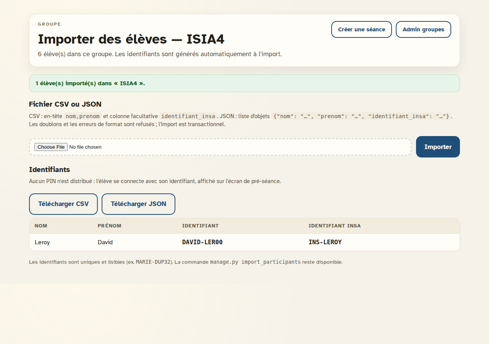
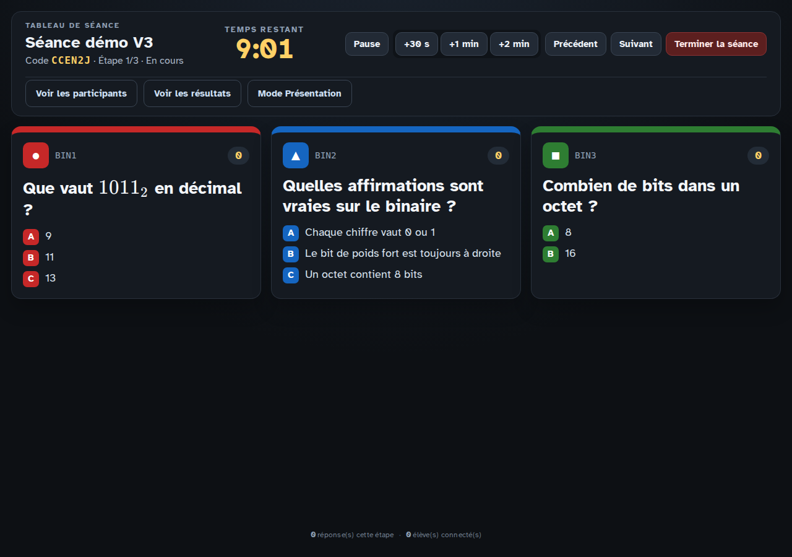
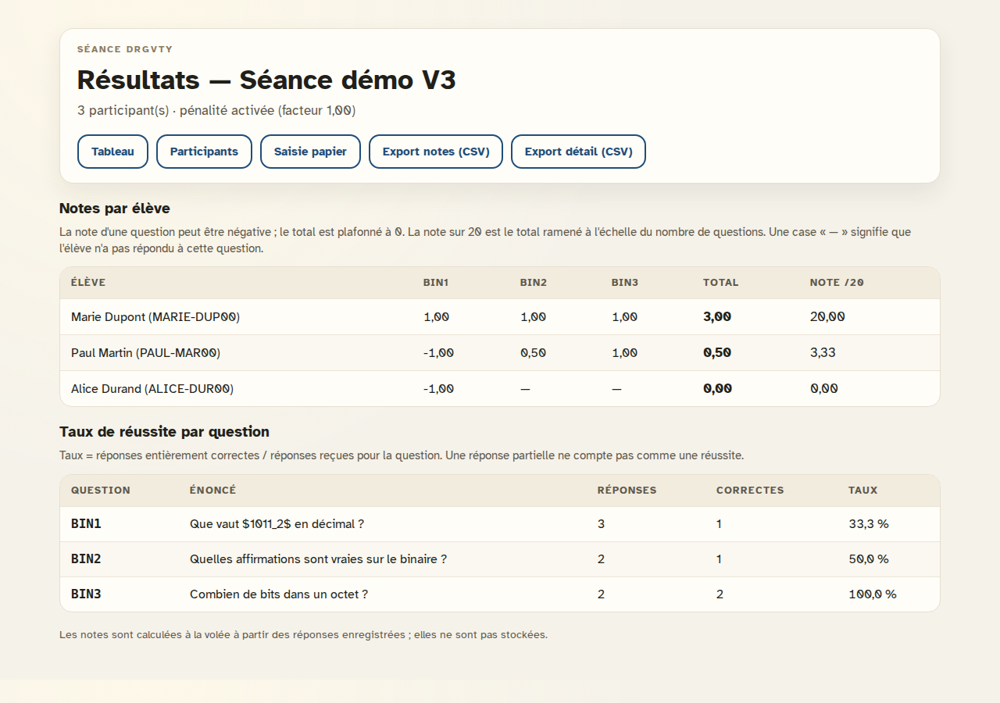
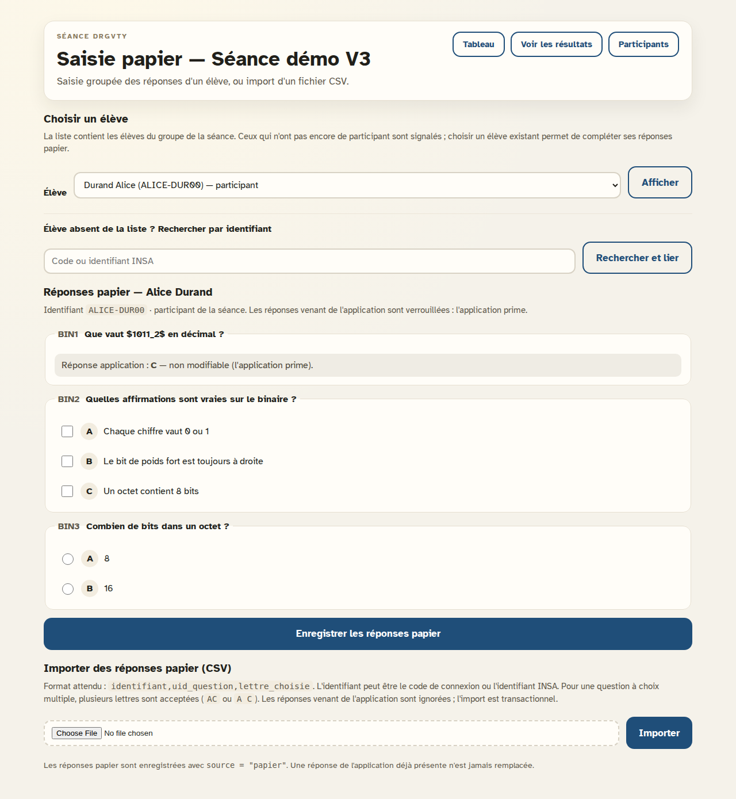

# Guide du professeur — QCM en direct

**Version du guide :** 1.0 — novembre 2026 (application V3)
**Public :** professeur de l'INSA Rouen, sans compétence technique particulière.
**En cas de problème :** voir la FAQ (§7) puis la section technique (§8).

> **Les captures d'écran.** Les liens vers `docs/screenshots/v3-fin/...`
> pointent vers des captures réelles de l'application. Les liens vers
> `docs/screenshots/guide/...` sont des emplacements à compléter par des
> captures sur le poste de l'INSA ; le dossier n'existe pas encore.

## Sommaire

1. [Présentation de l'application](#1-présentation-de-lapplication)
2. [Installation et lancement](#2-installation-et-lancement)
3. [Préparation d'une séance](#3-préparation-dune-séance)
4. [Déroulement de la séance](#4-déroulement-de-la-séance)
5. [Après la séance : résultats](#5-après-la-séance--résultats)
6. [Mode dégradé : copies papier](#6-mode-dégradé--copies-papier)
7. [Petit dépannage (FAQ)](#7-petit-dépannage-faq)
8. [Section technique (maintenance)](#8-section-technique-maintenance)

---

## 1. Présentation de l'application

L'application **QCM en direct** sert à faire répondre une classe entière à un
QCM pendant qu'il est projeté au tableau.

Le principe est simple :

- le professeur projette les questions et les choix sur le vidéoprojecteur ;
- chaque élève répond depuis son téléphone, dans un navigateur, sans installer
  d'application ;
- **le téléphone ne montre jamais l'énoncé ni le texte des réponses** : il
  affiche seulement une couleur, des lettres (A, B, C…) et le temps restant ;
- les réponses sont enregistrées par le serveur, qui calcule les notes ;
- le professeur consulte ensuite les résultats et télécharge les notes.

Chaque élève est identifié par un **identifiant** (par exemple `MARIE-DUP00`).
Il n'y a **aucun mot de passe ni PIN** : l'identifiant suffit.


> **À retenir.** L'application ne remplace pas le vidéoprojecteur : c'est le
> tableau qui porte les énoncés. Les téléphones ne servent qu'à voter.

---

## 2. Installation et lancement

### 2.1. Première installation (une seule fois)

L'installation se fait sur l'ordinateur qui fera tourner la séance (le
« serveur »). Prévoir Python 3.12 ou une version plus récente.

```bash
python3 -m venv .venv
source .venv/bin/activate
pip install -r requirements.txt
python manage.py migrate
python manage.py createsuperuser
```

Sous Windows, la deuxième commande est :

```bat
.venv\Scripts\activate
```

`createsuperuser` demande un nom d'utilisateur, un courriel et un mot de passe :
c'est le compte professeur qui donnera accès à l'administration.

Pour les séances suivantes, il suffit de réactiver l'environnement
(`source .venv/bin/activate` ou `.venv\Scripts\activate`) puis de lancer le
serveur.

### 2.2. Lancer le serveur

Dans le dossier du projet, terminal ouvert :

```bash
python manage.py runserver 0.0.0.0:8000
```

Laisser ce terminal ouvert pendant toute la séance : **fermer le terminal
coupe l'application**. Sur l'ordinateur, ouvrir ensuite
`http://127.0.0.1:8000/` dans un navigateur.

### 2.3. Trouver l'adresse du serveur sur le réseau

Les téléphones ne peuvent pas utiliser `127.0.0.1` : cette adresse désigne le
téléphone lui-même. Il faut l'adresse de l'ordinateur sur le Wi-Fi local, par
exemple `192.168.1.42`.

Pour la trouver :

- **Linux :** `hostname -I` (la première adresse IPv4) ;
- **macOS :** `ipconfig getifaddr en0` (ou `en1` selon l'interface) ;
- **Windows :** `ipconfig`, puis la ligne « Adresse IPv4 » de la carte Wi-Fi.

Le QR code affiché par l'application a besoin de cette adresse. Sans
configuration, il contient `127.0.0.1` et ne fonctionne pas sur les
téléphones. Indiquer l'adresse au lancement :

```bash
QCM_LAN_HOST=192.168.1.42:8000 python manage.py runserver 0.0.0.0:8000
```

Sous Windows PowerShell :

```powershell
$env:QCM_LAN_HOST="192.168.1.42:8000"
python manage.py runserver 0.0.0.0:8000
```

Il faut **arrêter puis relancer** le serveur après avoir changé cette valeur.
Le QR code et l'URL affichée sous le QR code pointent alors vers l'adresse
indiquée. Le QR code est présent sur la page initiale de la séance et sur le
tableau pendant l'attente.

> **Wi-Fi.** L'ordinateur et les téléphones doivent être sur le **même réseau
> Wi-Fi**, et ce réseau ne doit pas isoler les appareils (certains réseaux
> « invités » le font). Le pare-feu de l'ordinateur doit autoriser les
> connexions entrantes sur le port 8000.


---

## 3. Préparation d'une séance

La préparation se fait dans l'**espace professeur** (l'administration de
l'application). Elle peut être faite la veille ; elle n'a pas besoin des
téléphones.

### 3.1. Se connecter à l'administration

Ouvrir `http://127.0.0.1:8000/admin/` sur l'ordinateur (ou le bouton
« Espace professeur » de la page d'accueil), puis saisir le compte créé à
l'installation.


### 3.2. Créer un groupe et importer les élèves

1. Dans l'administration, ouvrir **Groupes**, puis **Ajouter**.
2. Donner un nom au groupe (par exemple `ISIA4`) et choisir le professeur
   propriétaire (vous).
3. Enregistrer. La page du groupe permet d'ajouter des élèves à la main, mais
   l'import est plus rapide.
4. Depuis la liste des groupes, cliquer sur le lien **Importer** du groupe.
5. Déposer un fichier CSV ou JSON, puis cliquer sur **Importer**.

Format CSV conseillé (UTF-8) :

```csv
nom,prenom,identifiant_insa
Dupont,Marie,INS-2024-001
Martin,Paul,
```

- `nom` et `prenom` sont obligatoires ;
- `identifiant_insa` est **facultatif** ; il sert aux exports de notes vers
  les outils de l'INSA ;
- les accents et les majuscules sont conservés.

Le même fichier au format JSON :

```json
[
  {"nom": "Dupont", "prenom": "Marie", "identifiant_insa": "INS-2024-001"},
  {"nom": "Martin", "prenom": "Paul"}
]
```

L'application génère automatiquement un **identifiant de connexion** unique
pour chaque élève (par exemple `MARIE-DUP00`). La page d'import affiche le
résumé et permet de télécharger la liste des identifiants en CSV ou JSON.
Les doublons et les lignes mal formées sont refusés : dans ce cas, rien n'est
importé et un message indique la ligne à corriger.



> **Sans identifiant INSA**, l'export de notes utilise l'identifiant de
> connexion. Ce n'est pas bloquant pour une séance.

### 3.3. Créer les questions (la banque de questions)

Les questions sont rangées dans des **ensembles**, réutilisables d'un QCM à
l'autre.

1. Ouvrir **Ensembles de questions**, puis **Ajouter**.
2. Donner un nom à l'ensemble (par exemple `Binaire — ISIA4`) et l'enregistrer.
3. Ajouter une ligne de question dans le tableau : identifiant court
   (`BIN1`), énoncé, type, durée, ordre.
4. Enregistrer, puis **ouvrir la question** pour saisir ses choix : lettre
   (A, B, C…), texte, et cocher la ou les bonnes réponses.
5. Pour une question à choix multiple, plusieurs réponses peuvent être
   correctes ; penser à cocher « Afficher l'indice choix multiple » si l'on
   veut que le tableau le signale.

Un ensemble peut aussi être rempli par **import** : sur la page de l'ensemble,
cliquer sur **Importer**. Formats acceptés :

- **JSON** : `{"questions": [{"uid": "BIN1", "enonce": "…", "type":
  "unique", "duree_s": 60, "choix": [{"lettre": "A", "texte": "…",
  "correct": true}]}]}` ;
- **CSV** : une ligne par choix, en-tête
  `uid,enonce,type,lettre,texte,correct[,duree_s]`.

Les fichiers d'exemple `examples/questions_demo.json` et
`examples/questions_demo.csv` peuvent servir de modèle.

> **Astuce.** Les formules mathématiques s'écrivent entre `$…$` (par exemple
> `$1011_2$`) : elles sont mises en forme sur le tableau.


### 3.4. Créer un QCM et sélectionner les questions

1. Ouvrir **QCM**, puis **Ajouter**.
2. Renseigner le titre, le professeur propriétaire, la durée par étape
   (60 secondes par défaut) et la politique de pénalité :
   - **Pénaliser les mauvaises réponses** : si la case est cochée, une
     mauvaise réponse retire des points ;
   - **Facteur de pénalité** : 1,0 par défaut ; laisser 1,0 sauf besoin
     particulier.
3. Enregistrer, puis cliquer sur **Sélectionner les questions**.
4. Dans la page de sélection, cocher les questions voulues (elles sont
   groupées par ensemble), puis cliquer sur **Ajouter au Quiz**.
5. Vérifier l'ordre dans la liste des questions sélectionnées. Une question
   peut être retirée depuis la page du QCM.

La durée d'une étape est au minimum la durée du QCM ; une question peut
allonger l'étape. L'ordre des questions est celui de la sélection.


### 3.5. Créer la séance

1. Depuis l'accueil, cliquer sur **Créer une séance** (ou ouvrir
   `/session/creer/`).
2. Choisir le QCM et le groupe. Pour une vraie classe, choisir le groupe :
   les élèves se connecteront avec leur identifiant.
3. Cliquer sur **Créer la séance**.

La page suivante affiche le **code de session** (6 caractères) et le **QR
code**. C'est cette page qu'il faut projeter ou laisser ouverte pour que les
élèves se connectent. Le bouton **Ouvrir le tableau** mène à l'écran de
pilotage.

> **Séance libre.** Sans groupe, la séance est ouverte à tous (mode
> démonstration). Pour une évaluation, toujours choisir un groupe.
>
> **PIN.** La page de création peut encore mentionner un « PIN » : c'est un
> reste d'une ancienne version. Aucun PIN n'est utilisé ; l'identifiant suffit.

Le code de session se retrouve aussi dans l'administration, rubrique
**Séances** (colonne « Code de session »).


---

## 4. Déroulement de la séance

### 4.1. Avant de démarrer : l'écran de pré-séance

Avant le début, ouvrir **Participants** depuis le tableau ou la page de la
séance. Cet écran affiche les élèves du groupe, leur identifiant et leur
statut.

- un élève qui se connecte passe au **vert** ;
- un élève encore absent reste en gris ;
- le compteur indique le nombre de connectés.

Les élèves lisent leur identifiant sur cet écran (ou sur la liste imprimée) et
le saisissent après avoir scanné le QR code. Si un élève s'est trompé
d'appareil, le bouton **Réinitialiser** de sa ligne libère l'appareil ; il
pourra se reconnecter.


> **Un appareil par élève.** Le premier élève qui se connecte sur un téléphone
> « réserve » cet appareil. Un autre élève ne peut pas l'utiliser sans une
> réinitialisation par le professeur. Deux onglets ouverts par le **même**
> élève sont acceptés.

### 4.2. Le tableau de bord du professeur

L'écran **Tableau** est l'écran de pilotage. Il affiche :

- le titre du QCM, le code de session, le statut et l'étape en cours ;
- le **temps restant** ;
- les questions de l'étape, avec leur couleur et le nombre de réponses
  reçues ;
- en pied de page, le nombre de réponses et de participants.

Les boutons disponibles :

| Bouton | Effet |
| :--- | :--- |
| **Démarrer** | Lance la première étape et le chronomètre. |
| **Pause** | Arrête le chronomètre ; les réponses ne sont plus acceptées. |
| **Reprendre** | Relance le chronomètre là où il s'était arrêté. |
| **+30 s / +1 min / +2 min** | Ajoute du temps à l'étape en cours. |
| **Précédent / Suivant** | Change d'étape manuellement. |
| **Terminer la séance** | Clôture la séance et enregistre les résultats. |

Le chronomètre fait avancer la séance automatiquement : à la fin du temps,
l'étape suivante s'affiche. Après la dernière étape, la séance se termine
automatiquement.



### 4.3. Ce que font les élèves

1. Scanner le QR code ou ouvrir `http://<adresse-du-serveur>:8000/rejoindre/`.
2. Saisir le code de session, puis leur identifiant.
3. Attendre le démarrage : l'écran affiche « En attente du professeur ».
4. Pendant la séance, le téléphone affiche une **couleur** et des **lettres**
   (A, B, C…). L'élève doit répondre à la question de cette couleur au
   tableau, puis appuyer sur **Valider**.
5. Une réponse est **définitive** : elle ne peut pas être modifiée. La
   confirmation « Réponse validée » n'apparaît qu'après l'accusé de réception
   du serveur.

Les téléphones n'affichent **jamais** l'énoncé, le texte des réponses ni la
bonne réponse. C'est voulu : le contenu reste sur le vidéoprojecteur.


> **Réseau instable.** Si le Wi-Fi coupe quelques instants, la réponse est
> gardée sur le téléphone et envoyée dès que le réseau revient. Il ne faut pas
> fermer la page. Une réponse arrivée après la fin du chronomètre est refusée.

### 4.4. Mode Présentation

Le bouton **Mode Présentation** ouvre une vue plein écran, sans boutons de
contrôle, à projeter sur le vidéoprojecteur. Garder l'écran **Tableau** sur
l'ordinateur pour piloter (pause, temps, étape suivante).


---

## 5. Après la séance : résultats

### 5.1. Ouvrir la page des résultats

Plusieurs chemins mènent aux résultats :

- depuis le **Tableau**, cliquer sur **Voir les résultats** ;
- dans l'administration, ouvrir **Séances** : la colonne **Résultats**
  propose **Voir les résultats** pour une séance en cours ou terminée ;
- l'URL directe est `/resultats/<code-de-session>/`.

La page affiche :

- **Notes par élève** : le total brut (plancher 0) et la **note /20** ;
- **Taux de réussite par question** : nombre de réponses, nombre de réponses
  entièrement correctes et pourcentage.

Une case « — » signifie que l'élève n'a pas répondu à la question. Une note
de question peut être négative ; le total de la séance est plafonné à 0.



> **Note /20.** Le total brut est la somme des points des questions. La note
> /20 ramène ce total à l'échelle du nombre de questions de la séance. Les
> notes sont calculées au moment de l'affichage ; elles ne sont pas stockées.

### 5.2. Télécharger les notes (CSV pour Excel)

Sur la page des résultats, deux boutons téléchargent des fichiers CSV :

- **Export notes (CSV)** : une ligne par élève, avec `Nom`, `Prénom`,
  `Identifiant`, `Note /20`, puis une colonne par question contenant la ou
  les lettres choisies ;
- **Export détail (CSV)** : une ligne par élève et par question, avec
  l'énoncé court, la réponse donnée, la bonne réponse et les points obtenus.

L'identifiant exporté est l'**identifiant INSA** s'il a été renseigné, sinon
l'identifiant de connexion. Les fichiers sont encodés en **UTF-8 avec BOM** et
utilisent la **virgule** comme séparateur : c'est le format prévu pour
s'ouvrir correctement dans Excel.

Pour ouvrir un fichier dans Excel :

1. double-cliquer sur le fichier ;
2. si toutes les colonnes arrivent dans une seule, utiliser
   **Données → Obtenir des données → À partir d'un fichier texte/CSV**, puis
   choisir la virgule comme séparateur et UTF-8 comme encodage.

Les noms de fichiers sont `notes_<code>.csv` et `detail_<code>.csv`. Ne pas
renommer les colonnes avant l'import dans les outils de l'INSA.

> **Décimales.** Les notes du CSV utilisent le point décimal (`15.00`) car la
> virgule sépare déjà les colonnes. Dans Excel, vérifier le format de la
> colonne « Note /20 ».

---

## 6. Mode dégradé : copies papier

Le mode papier sert aux élèves qui ont répondu sur une copie, sans téléphone
ou sans connexion. Les réponses papier sont saisies dans l'application et
comptent comme les autres.

### 6.1. Saisir les réponses d'un élève

1. Ouvrir la page des résultats, puis cliquer sur **Saisie papier**
   (ou ouvrir `/session/<code>/saisie-papier/`).
2. Choisir l'élève dans la liste déroulante. Les élèves sans participant sont
   signalés.
3. Si l'élève n'est pas dans la liste, saisir son **identifiant** (ou son
   identifiant INSA) dans le champ de recherche, puis cliquer sur
   **Rechercher et lier**.
4. Cocher les réponses de la copie : boutons radio pour une question à choix
   unique, cases à cocher pour une question à choix multiple.
5. Cliquer sur **Enregistrer les réponses papier**. Le participant est créé
   automatiquement s'il n'existait pas.

Les réponses déjà données dans l'application sont affichées en lecture seule :
**l'application prime**, elles ne sont jamais remplacées. Une réponse papier
déjà saisie peut être corrigée en changeant la sélection.



### 6.2. Importer un fichier CSV de réponses papier

Sur la même page, le bouton **Importer** accepte un CSV au format :

```csv
identifiant,uid_question,lettre_choisie
MARIE-DUP00,BIN1,B
MARIE-DUP00,BIN2,AC
PAUL-MAR00,BIN3,A
```

- `identifiant` : l'identifiant de connexion **ou** l'identifiant INSA ;
- `uid_question` : l'identifiant de la question dans le QCM (`BIN1`, etc.) ;
- `lettre_choisie` : une lettre, ou plusieurs pour une question à choix
  multiple (`AC` ou `A C`).

L'import est **transactionnel** : si une ligne est invalide, aucune réponse
n'est enregistrée et un message indique la ligne à corriger. Les réponses
venant de l'application sont **ignorées** (l'application prime) ; les
participants manquants sont créés. Le fichier doit être en UTF-8.

### 6.3. Ajout manuel de secours

Pour une correction ponctuelle, l'administration propose aussi
**Réponses → Ajouter** :

- choisir l'élève et la question ;
- saisir les lettres sous forme de liste JSON, par exemple `["A"]` ou
  `["A", "C"]` ;
- laisser la source **Papier** (valeur par défaut) ;
- enregistrer.

Le formulaire refuse la création si une réponse de l'application existe déjà
pour cet élève et cette question.

### 6.4. Fusion application / papier

- Une réponse **application** ne peut pas être remplacée par une réponse
  papier : l'application prime.
- Une réponse **papier** peut être corrigée par la saisie groupée ou par un
  nouvel import.
- Les deux types de réponses apparaissent ensemble dans les résultats et les
  exports.

---

## 7. Petit dépannage (FAQ)

### « Les téléphones ne se connectent pas »

Vérifier dans cet ordre :

1. le serveur est bien lancé et le terminal est resté ouvert ;
2. l'ordinateur et les téléphones sont sur le **même Wi-Fi** (pas un réseau
   invité qui isole les appareils) ;
3. l'adresse utilisée est celle de l'ordinateur (`192.168.x.x`), pas
   `127.0.0.1` ;
4. le QR code et l'URL ont été générés avec `QCM_LAN_HOST` (voir §2.3) ;
5. le pare-feu de l'ordinateur autorise les connexions sur le port 8000 ;
6. le téléphone n'est pas sur un VPN ou un partage de connexion.

Tester directement `http://<adresse>:8000/rejoindre/` dans le navigateur du
téléphone.

### « Le QR code ne fonctionne pas »

Le QR code contient l'adresse du serveur. S'il contient `127.0.0.1`, il ne
peut pas fonctionner depuis un téléphone. Configurer `QCM_LAN_HOST`,
redémarrer le serveur, puis rouvrir la page de la séance pour régénérer le QR
code.

### « J'ai perdu le code de session »

Ouvrir l'administration, rubrique **Séances** : la colonne « Code de session »
affiche le code. Il est aussi visible sur la page du tableau et sur la page
initiale de la séance.

### « Un élève a ouvert deux onglets »

Deux onglets du **même élève** sur le même téléphone sont acceptés. Si un
autre élève tente d'utiliser le même téléphone, la connexion est refusée.
Dans ce cas :

1. ouvrir **Participants** ;
2. cliquer sur **Réinitialiser** sur la ligne de l'élève concerné ;
3. demander à l'élève de se reconnecter.

La réinitialisation libère l'appareil mais conserve les réponses déjà
enregistrées.

### « L'élève ne trouve pas son identifiant »

L'identifiant est affiché sur l'écran de pré-séance et dans la liste
téléchargeable après l'import. Il ne contient ni espace ni accent. En cas de
doute, le rechercher dans l'administration, rubrique **Élèves (Base)**.

### « Les réponses n'apparaissent pas au tableau »

Les compteurs se mettent à jour en quelques secondes. Vérifier que la séance
est bien **En cours** (bouton **Démarrer**), que l'élève a validé sa réponse
et que son téléphone est connecté au bon Wi-Fi. Une réponse validée après la
fin du chronomètre est refusée.

### « Une page mentionne un PIN »

Certaines pages anciennes peuvent encore afficher le mot « PIN ». **Aucun PIN
n'est utilisé** : l'élève se connecte uniquement avec son identifiant. Ignorer
cette mention.

### « Le serveur a été coupé pendant la séance »

Relancer le serveur avec la même commande. Les réponses déjà reçues sont
conservées. La séance reprend à l'étape en cours si le temps de cette étape
n'est pas écoulé ; sinon elle avance à l'étape suivante (ou se termine si
c'était la dernière). Les téléphones peuvent garder la page ouverte.

---

## 8. Section technique (maintenance)

Cette section s'adresse à la personne qui administre le serveur. Le reste du
guide n'en a pas besoin.

### 8.1. Où sont les fichiers

| Élément | Rôle |
| :--- | :--- |
| `manage.py` | Point d'entrée des commandes (serveur, migrations, imports). |
| `config/settings.py` | Configuration : base de données, hôtes, `QCM_LAN_HOST`. |
| `qcm/` | Cœur de l'application : pages, réponses, notes, imports, tests. |
| `qcm/tests/` | Tests automatiques. |
| `templates/` | Pages HTML. |
| `static/` | Styles, scripts et polices. |
| `examples/` | Fichiers CSV/JSON de démonstration. |
| `docs/` | Spécification, architecture, décisions et captures. |
| `GUIDE_PROF.md` | Le présent guide. |
| `db.sqlite3` | Base de données par défaut (créée au premier `migrate`). |
| `media/` | Images de questions, si utilisées. |

### 8.2. Passer de SQLite à PostgreSQL

Par défaut, l'application utilise SQLite (`db.sqlite3`) pour le
développement et la démonstration. Pour l'école, PostgreSQL est recommandé.

1. Installer le pilote PostgreSQL :

   ```bash
   pip install "psycopg[binary]"
   ```

   Ajouter la version épinglée dans `requirements.txt`.

2. Créer une base et un utilisateur PostgreSQL (avec un administrateur de la
   base).

3. Dans `config/settings.py`, remplacer le bloc `DATABASES` par exemple par :

   ```python
   DATABASES = {
       "default": {
           "ENGINE": "django.db.backends.postgresql",
           "NAME": "qcm",
           "USER": "qcm",
           "PASSWORD": "mot-de-passe",
           "HOST": "127.0.0.1",
           "PORT": "5432",
       }
   }
   ```

   Ne pas mettre de mot de passe en clair dans un dépôt public : utiliser des
   variables d'environnement.

4. Appliquer le schéma :

   ```bash
   python manage.py migrate
   ```

5. Pour reprendre les données existantes, faire une sauvegarde puis utiliser
   `python manage.py dumpdata` sur l'ancienne base et
   `python manage.py loaddata` sur la nouvelle. Tester sur une copie avant la
   bascule. Les fichiers de `media/` sont à copier séparément.

Le code applicatif utilise l'ORM Django. Les seuls réglages spécifiques à
SQLite (mode WAL, dans `qcm/apps.py`) vérifient le moteur et sont ignorés
automatiquement sous PostgreSQL.

### 8.3. Lancer les tests et les vérifications

```bash
pytest
ruff check .
python manage.py check
python manage.py makemigrations --check --dry-run
```

Les tests couvrent notamment l'import, la notation, le refus tardif, le
doublon de réponse et l'absence d'énoncé dans les réponses destinées aux
téléphones.

### 8.4. Sécurité et principes

- **Aucun énoncé, texte de choix ni `est_correct` n'est envoyé aux
  téléphones.** Le test `qcm/tests/test_securite.py` le vérifie.
- **Le serveur est la seule référence temporelle** : `ends_at` est stocké en
  base ; le client ne fait qu'afficher un décompte.
- **Une réponse après la fin du chronomètre est refusée**, et une seule
  réponse est acceptée par couple (élève, question).
- **Pas de PIN** : l'identification repose sur `code_etudiant`.
- Le temps réel utilise un **polling** périodique des pages ; il n'y a ni
  WebSocket ni SSE.

### 8.5. Mettre à jour l'application

```bash
git pull
source .venv/bin/activate
pip install -r requirements.txt
python manage.py migrate
```

Sauvegarder `db.sqlite3` (ou la base PostgreSQL) avant toute mise à jour.
Redémarrer ensuite `runserver`. Les migrations sont conçues pour conserver les
données existantes.

### 8.6. Imports en ligne de commande

Les imports de démonstration peuvent aussi être lancés dans le terminal :

```bash
python manage.py import_participants examples/groupe_demo.csv --groupe ISIA4
python manage.py import_quiz examples/quiz_demo.json --proprietaire <utilisateur>
```

Remplacer `<utilisateur>` par le nom du compte professeur. La commande
`import_participants` recherche le groupe sans tenir compte de la casse ;
`import_quiz` crée un ensemble de questions et un QCM qui les sélectionne.

---

*Guide rédigé pour l'application QCM en direct — PAO INSA Rouen.*
